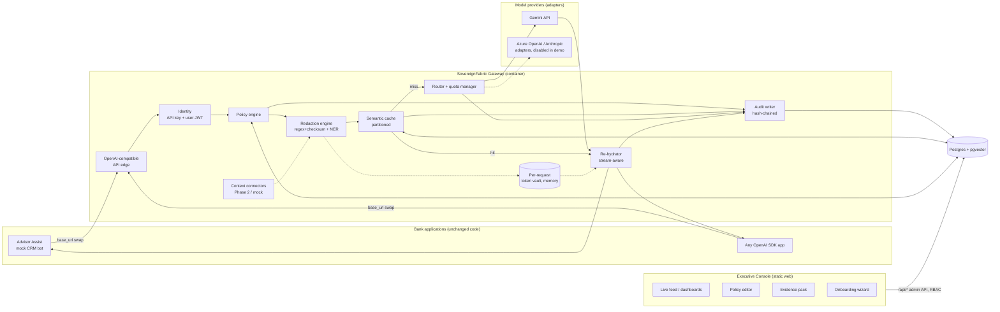
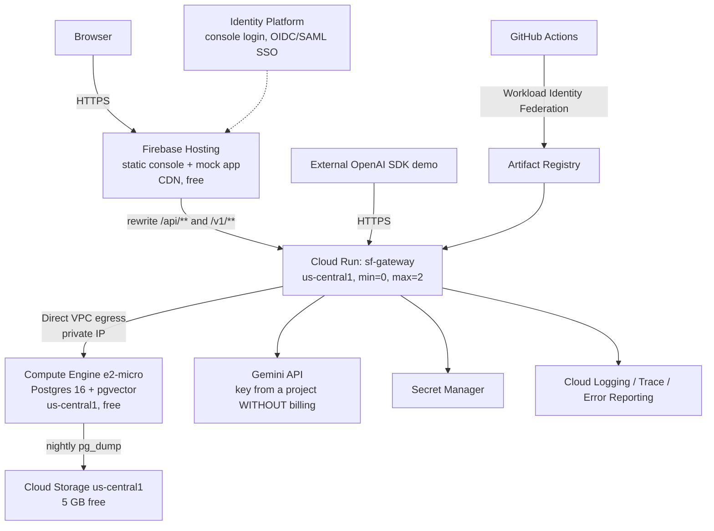

# SovereignFabric — System Design

**Status:** Draft v1 · 2026-10-14
**Scope:** The production architecture of the SovereignFabric AI Control Gateway, and a hosted demo of it that costs nothing to run on Google Cloud Platform (GCP) using only Gemini APIs.

---

## 0. TL;DR

SovereignFabric is an **OpenAI-compatible reverse proxy**. A bank's existing AI apps change one line, `BASE_URL`, and every request then passes through an inline pipeline:

**identify → enforce policy → redact → cache → route → re-hydrate → audit**

Executives, risk and compliance see the results in a role-gated console.

Two deployment shapes, one codebase:

| | **Hosted demo (this plan)** | **Customer production** |
|---|---|---|
| Where | GCP free tier, `us-central1` | The bank's own network: their VPC, `australia-southeast1/2`, or on-premises |
| Packaging | Cloud Run + Firebase Hosting + e2-micro VM | Docker images + Helm chart |
| Database | Postgres 16 + pgvector on the free e2-micro VM | The bank's managed Postgres (Cloud SQL / AlloyDB / RDS / on-prem) |
| LLM | Gemini API, free tier | Gemini on Vertex AI / Azure OpenAI / Anthropic under the bank's paid, no-training terms |
| Data | **Synthetic only** | Real |
| Cost | $0 (with a $1 budget alarm) | Licensed |

The hosted demo runs **the same containers and the same code paths** as production. Only configuration differs. That's the claim we want to be able to make to investors and to a bank architect, honestly.

---

## 1. Goals and non-goals

### Goals (v1)
1. **Drop-in OpenAI compatibility:** `/v1/chat/completions` (streaming and non-streaming), `/v1/models`, `/v1/embeddings`. Unmodified OpenAI SDKs (Python and Node) work after a `base_url` change.
2. **Identity:** know which *app* and, where the app forwards it, which *end user* made each request.
3. **Policy as data:** per-tenant, per-department rules for data classes, models and rate limits, editable in the console, versioned, with every change audited.
4. **Redaction:** Australian identifiers (TFN, Medicare, ABN, card, phone, email) via regex + checksum, plus named-entity recognition (NER) for names and addresses. Runs **locally** and never calls an LLM to find PII.
5. **Reversible tokenization and stateful re-hydration**, including for streamed responses.
6. **Semantic cache** that is partitioned by entitlement and safe across users.
7. **Model routing** across tiers, with quota-aware fallback.
8. **Tamper-evident audit log** that never stores raw PII.
9. **Role-gated executive console:** live feed, risk dashboards, per-user and per-app drill-down, policy editor, CPS 230 / CPS 234 evidence pack.
10. **Demo assets:** a mock bank app ("Advisor Assist") showing the one-line swap, a synthetic workforce, and a traffic simulator.
11. **Packaging:** Docker images, docker-compose for evaluation, Helm chart, Terraform for the GCP demo, and offline-verifiable license files.

### Non-goals (v1, roadmap only)
- **Zero-copy connectors to real core-banking systems** (DB2/Oracle replicas, change-data-capture streams). v1 ships *one* mocked read-replica connector to prove the pattern (§9). Real connectors are built for each customer in Phase 2.
- **Capturing staff use of consumer chatbots in the browser** (chatgpt.com). That requires the bank's web proxy (Zscaler or Netskope) plus egress blocking. We document the integration rather than building it.
- Multi-region high availability, SOC 2 / IRAP certification, and a customer-managed key service.

---

## 2. Positioning constraints (these shape the design)

- **Transparent, not covert.** In Australia, NSW workplace surveillance law requires prior written notice for computer surveillance, and APRA-regulated entities answer to CPS 234 and the Privacy Act. The product is *invisible to staff workflow* but *disclosed by policy*. The console has an "Employee notice" setting, and the mock app shows the notice banner.
- **Monitor apps, not people, by default.** Per-user analytics only exist when an app forwards user identity. A tenant setting (`privacy_mode`) can pseudonymise users in executive views.
- **"Evidence pack", not "automatic compliance".** Reports are mapped to CPS 230 / CPS 234 control areas as supporting evidence. We never claim they *are* the compliance report.
- **Branding.** The hosted demo uses a fictional tenant ("Harbour Bank"). Never put a real bank's name or logo on a publicly reachable URL. The tenant display name is configurable for a private meeting.

---

## 3. Architecture

### 3.1 Logical components



### 3.2 Request lifecycle (`POST /v1/chat/completions`)

| # | Stage | What happens | Fails closed? |
|---|---|---|---|
| 1 | **Edge** | Validate OpenAI request schema and size limits; assign `request_id`; start trace span | yes, 400 |
| 2 | **Identify** | `Authorization: Bearer sf-…` → look up hashed app key → `app`, `tenant`, default department. Optional end user from `X-SF-User-Token` (signed JWT from the bank's identity provider) or from OpenAI's `user` field (unverified, labelled as such) | yes, 401 |
| 3 | **Rate limit** | Token bucket per tenant, app and user (in memory, with a Postgres-backed counter for exactness across instances) | yes, 429 |
| 4 | **Classify** | Redaction engine scans **all** message contents (system, user, tool results): regex + checksum validators first, then NER | n/a |
| 5 | **Policy** | Rules evaluated against (department, data classes found, requested model, app). Each data class resolves to an action: `allow` · `redact` · `block` | yes, 403 in OpenAI error format |
| 6 | **Tokenize** | Replace each detected span with a **deterministic ordinal token** such as `⟦AU_TFN_1⟧` or `⟦EMAIL_2⟧`. Mapping kept in a per-request vault in memory only | n/a |
| 7 | **Cache lookup** | Embed the *redacted* prompt and nearest-neighbour search **within the partition** (`tenant, entitlement_scope, model_tier`). A hit also requires the same token signature (§6) | miss on any error |
| 8 | **Route** | Complexity scorer picks a tier; quota manager picks a concrete model; fallback chain on 429 or 5xx | 503 after the chain is exhausted |
| 9 | **Call provider** | Adapter translates to the provider. Gemini is called through its OpenAI-compatible endpoint, so the adapter is thin | — |
| 10 | **Output scan** | Scan the model output for *new* PII the model introduced; apply the policy again | redact |
| 11 | **Re-hydrate** | Swap tokens back to real values (if policy allows re-hydration for that data class); streaming-safe buffering (§5) | — |
| 12 | **Audit** | Write a hash-chained event with redacted prompt and response, decisions, model, tokens, cost, latency, cache result; publish to the live feed | async, retried; a buffer overflow raises an alert |

Latency budget for the gateway's own work, excluding the model call: p50 < 40 ms, p95 < 120 ms. NER is the largest part.

### 3.3 Deployment on GCP (free tier)



**Why these choices**

| Need | Choice | Why | Rejected |
|---|---|---|---|
| Compute | **Cloud Run** (request-based billing, scale to zero) | 2M requests, 180k vCPU-seconds and 360k GB-seconds a month free; HTTPS; streaming support | GKE Autopilot (no free tier) |
| Database | **Postgres + pgvector on the free e2-micro** | Same engine the bank runs on-prem, so the demo exercises the real production database path; vector search and `LISTEN/NOTIFY` included | Cloud SQL / AlloyDB (no free tier); Firestore (would mean a second storage backend that doesn't exist on-prem) |
| Cloud Run → database | **Direct VPC egress** | No Serverless VPC Access connector, which would be billed VMs; private IP only, no public database port | Public IP + allowlist (Cloud Run egress IPs aren't static) |
| Web hosting | **Firebase Hosting, Next.js static export** | Free CDN with no cold start; rewrites `/api/**` to Cloud Run, so it's same-origin with no CORS | Next.js server on Cloud Run (cold starts on the page itself) |
| Auth (console) | **Identity Platform** (email/password + OIDC/SAML for a "Sign in with Entra ID" demo) | Native to GCP; the free tier covers demo usage | Supabase (works, but isn't GCP) |
| Secrets | **Secret Manager** | 6 active secret versions are free, which is enough (§10.3) | `.env` in the image |
| CI/CD | **GitHub Actions + Workload Identity Federation** | No long-lived keys; `.github/workflows/ci.yml` already exists | Service account JSON keys |
| Observability | Cloud Logging (structured JSON), Cloud Trace (OpenTelemetry), Error Reporting | Free allowances are well above demo volume | Third-party APM |

**Region note.** The always-free e2-micro and Cloud Storage free tier exist only in `us-west1`, `us-central1` and `us-east1`. Direct VPC egress needs Cloud Run in the VM's region, so **the whole demo runs in `us-central1`**. That's acceptable *because the demo holds only synthetic data*. Say so on the onboarding screen and in the pitch: "Production deploys inside your network in Sydney or Melbourne; this demo is synthetic data on free US infrastructure." The Terraform takes `region` as a variable, so an Australian deployment is a one-line change.

### 3.4 Free-tier budget (demo scale)

| Resource | Free allowance | Expected demo usage | Headroom |
|---|---|---|---|
| Cloud Run requests | 2,000,000 / month | < 50,000 | 40× |
| Cloud Run vCPU-seconds | 180,000 / month | 1 vCPU × ~15 h active ≈ 54,000 | 3× |
| Cloud Run GB-seconds | 360,000 / month | 1 GiB × ~15 h ≈ 54,000 | 6× |
| e2-micro VM | 1 instance, 30 GB disk | 1 instance, 20 GB | ok |
| Cloud Storage | 5 GB (US regions) | backups < 500 MB (7-day retention) | ok |
| Artifact Registry | 0.5 GB | gateway image ~250 MB × 2 kept | tight: cleanup policy keeps the last 2 |
| Cloud Build / Actions | 2,500 build-min / 2,000 min | < 300 | ok |
| Secret Manager | 6 versions | 4 to 5 | ok, but destroy old versions on rotation |
| Gemini API | Free-tier RPM/RPD per model (see AI Studio) | Presenter traffic only; the simulator doesn't call Gemini | §7.3 |

**Cost guardrails (do these first):**
1. Billing budget of **$1** with email alerts at 50%, 90% and 100%.
2. Cloud Run `max-instances=2`, `min-instances=0`, `cpu-boost` on startup.
3. **Create the Gemini API key in a separate project that has no billing account.** Gemini usage counts as *paid* when the key's project has billing enabled. If the key lives in the hosting project (which needs billing for Cloud Run), Gemini calls are billed.
4. Artifact Registry cleanup policy; log exclusion for health-check noise.

---

## 4. Identity, tenancy and access control

### 4.1 Principals
| Principal | Authenticates with | Used by |
|---|---|---|
| **App** (service) | `sf-live-…` virtual API key (shown once, stored as SHA-256 hash and prefix) | Bank applications calling `/v1/*` |
| **End user** (optional) | `X-SF-User-Token`: JWT from the bank's identity provider, verified against its JWKS, set up during onboarding | Per-user policy and analytics |
| **Console user** | Identity Platform ID token (JWT, verified against Google's JWKS) | Humans using the console |

If an app sends no user token, events are attributed to the app plus OpenAI's `user` field marked **unverified**. The console shows coverage: "% of traffic with verified user identity". This answers the investor question "how do you know who sent it?" honestly.

### 4.2 Console roles (enforced on the server for every `/api/*` route)

| Role | Can see | Can do |
|---|---|---|
| `platform_admin` (us) | All tenants | Issue licenses, create tenants |
| `tenant_admin` (bank IT) | Settings, apps, keys | Onboarding, SSO, create app keys; **cannot** see prompt contents |
| `executive` (CEO / COO / CRO) | Dashboards, risk, trends, per-business-unit; per-user only if `privacy_mode=off` | Approve policy changes |
| `ciso` / `compliance` | Everything above + redacted audit detail + evidence packs | Draft policies, export reports, investigate a user |
| `developer` | Their own apps' usage and errors | Rotate their app keys |
| *(employees)* | **No console access** | Use bank apps only |

Implementation: a FastAPI dependency `require_role(*roles)` on every admin route, plus Postgres row-level security keyed on `tenant_id` as a second layer. Contract tests assert that every `/api/*` route rejects unauthenticated callers and the wrong role. This closes the current gap where `/api/audit-logs` and `/api/stats/*` are open.

**Demo persona switcher:** in `DEMO_MODE`, the console header has "View as: Executive / CISO / Tenant admin / Developer". It mints a short-lived demo token for a seeded persona, so the presenter can *show* access being denied. It's disabled when `DEMO_MODE=false`.

### 4.3 Tenancy
Every table carries `tenant_id`. The hosted demo has one tenant, "Harbour Bank (fictional)", plus a "Blank tenant" that the onboarding wizard fills in live.

---

## 5. Redaction, tokenization and re-hydration

### 5.1 Detection (local only)
1. **Validated patterns** (fast, high precision): TFN (mod-11), Medicare (weighted mod-10), ABN (mod-89), card (Luhn), BSB+account, AU phone, email, IBAN/SWIFT. The existing [redaction.py](../api/redaction.py) already covers most of these.
2. **NER** (Microsoft Presidio + spaCy `en_core_web_md`, CPU) for PERSON, LOCATION/address and DATE_OF_BIRTH context. Loaded once at startup, about 150 MB of RAM.
3. **Custom deny-lists per tenant** (project codenames, internal hostnames).
4. **Never** send raw text to an LLM to *find* PII. That would defeat the purpose of the product.

Confidence: each detection has a score. Policy can set a threshold per data class. Low-confidence NER hits default to `redact`, because a false positive is cheap and a false negative is a breach.

### 5.2 Token format
`⟦{TYPE}_{n}⟧`, where `n` is the ordinal of that type within the request (e.g. `⟦AU_TFN_1⟧`, `⟦PERSON_2⟧`).
- The bracket glyphs rarely appear in normal text, and models copy them back reliably. The system prompt adds: *"Preserve ⟦…⟧ placeholders exactly."*
- **Deterministic ordinals instead of random IDs** let a cached response be re-hydrated with a *different* request's values (§6).
- The same original value within a request gets the same token.

### 5.3 Re-hydration
- The vault is a dict in memory scoped to the request. It's **never persisted or logged**, and it's dropped when the response completes.
- Policy decides, per data class, whether to re-hydrate (e.g. show the TFN back to an authorised agent) or leave the token in place (e.g. card numbers are never shown again).
- **Streaming:** a small state machine buffers from `⟦` until `⟧` or 32 characters, then emits the substituted text. Unmatched or mangled tokens are emitted as-is, flagged in the audit event, and counted as a quality metric.
- **Output scan:** the re-hydrated response is *not* re-scanned (it holds legitimate values); the provider's raw output *is* scanned before re-hydration to catch PII the model invented.

---

## 6. Semantic cache (safe across users)

**Cache key partition:** `(tenant_id, entitlement_scope, model_tier, context_fingerprint)`
- `entitlement_scope` = hash of the department plus its effective policy version. A Finance answer is never served to Technology, and changing a policy invalidates the partition automatically.
- `context_fingerprint` = hash of any context injected by connectors (§9). Answers that depend on a customer's data only hit for the same context.

**A hit requires all of:**
1. cosine similarity ≥ threshold (default 0.92, tunable per tenant) within the partition
2. **identical token signature**: the multiset of token types/ordinals in the prompt matches (e.g. `{AU_TFN_1, EMAIL_1}`)
3. the entry is younger than its TTL (default 24 h)
4. the request isn't marked `cache: no-store` (header or app setting)

**Stored:** redacted prompt, redacted response (tokens intact), embedding, metadata. On a hit, the *current* request's vault re-hydrates the cached response. User A's values can never reach user B.

**Embeddings:** `gemini-embedding-001` with `output_dimensionality=768`, stored in pgvector with an HNSW index. If the embedding quota is exhausted, fall back to a local hashed embedding (today's demo implementation) and mark the cache "degraded" in metrics.

---

## 7. Model routing and the quota manager

### 7.1 Provider adapters
`ProviderAdapter` interface: `chat(req) / stream(req) / embed(req) / health()`. v1 ships:
- **`gemini`**, through Gemini's OpenAI-compatible endpoint (`https://generativelanguage.googleapis.com/v1beta/openai/`), using the official `openai` Python SDK. Translation is minimal.
- **`simulated`**: deterministic canned responses with realistic latency and cost. Used by the traffic simulator, and as the last-resort fallback (always labelled "simulated" in the UI and audit log).
- Stubs for `azure_openai` and `anthropic`, disabled in the demo, which show the routing design is provider-neutral.

### 7.2 Tiers (model IDs come from config only and are never hard-coded)
| Tier | Purpose | Demo model (verify current IDs and free-tier limits in AI Studio) |
|---|---|---|
| `fast` | Short, routine prompts | a current Flash-Lite model |
| `balanced` | Default | a current Flash model |
| `deep` | Analysis, audit, reconciliation | the most capable model the free tier allows; fall back to `balanced` if it isn't on the free tier |

> The current [.env.example](../api/.env.example) defaults (`gemini-2.0-flash`, `text-embedding-004`) are **shut down**. Production mode fails until they're updated. Fix this in Phase 0.

The complexity scorer starts from today's keyword heuristic and adds token count, number of messages and tool use. Later, a small local classifier.

### 7.3 Quota manager
- A per-model token bucket configured from the free-tier RPM/RPD (in config), tracked in Postgres so all instances share it.
- Fallback chain: `deep → balanced → fast → simulated`. Each step is recorded in the pipeline trace ("deep tier quota reached → served by balanced").
- **Demo safety:** the presenter's live calls get priority; the simulator never touches Gemini.

---

## 8. Policy engine

Policies are stored as versioned JSON documents per tenant:

```json
{
  "version": 7,
  "departments": {
    "technology": {
      "data_classes": { "CREDIT_CARD": "block", "AU_TFN": "block", "EMAIL": "redact", "*": "redact" },
      "rehydrate":    { "EMAIL": true, "CREDIT_CARD": false },
      "models":       { "max_tier": "balanced" },
      "rate_limit":   { "per_user_per_min": 20 }
    }
  },
  "global": {
    "prompt_injection": "flag",
    "deny_terms": ["Project Kestrel"],
    "privacy_mode": "pseudonymise_users_for_executives"
  }
}
```

- **Change workflow:** a CISO drafts → an executive approves (two-person rule, which can be turned off in the demo) → the policy activates and gets a new `entitlement_scope`, which invalidates the cache partitions. Every change is an audit event with a diff.
- **Policy simulator:** "test this prompt against draft v8" shows the decision before publishing.
- **Prompt-injection check (v1):** heuristics and patterns, action `flag` or `block`. Optional v1.1: a Gemini classifier run on the *already-redacted* prompt.

---

## 9. Zero-copy context connectors (Phase 2; one mock in v1)

**Pattern:** the gateway exposes tools to the model (function calling), such as `get_customer_summary(customer_ref)`. When the model calls one:
1. The gateway resolves `customer_ref`. If it's a token like `⟦CUSTOMER_ID_1⟧`, the real ID comes from the vault, locally.
2. It runs a **parameterised, allow-listed query** against a **read-only replica**, under a database role with `SELECT` on approved views only, and with row-level entitlement checks for the calling user's department.
3. Results go through the redaction engine before they're returned to the model.
4. Rows read and the query ID are audited (not the values). Nothing is cached unless `context_fingerprint` matches.

**v1 mock:** a `core_banking_replica` schema (customers, accounts, transactions; about 200 synthetic customers) in the same Postgres, reached through a separate read-only role. This shows the pattern working, including the "pulled 12 rows, 3 fields redacted" trace.

**Phase 2 (per customer):** connectors for DB2 z/OS, Oracle and SQL Server through their read replicas; change-data-capture via Debezium, or Datastream on GCP, to keep a context index fresh. **Be explicit with investors and banks that this is per-customer integration work.**

---

## 10. Data model, audit and security

### 10.1 Core tables (Postgres)
`tenants`, `licenses`, `departments`, `console_users`, `apps`, `app_keys`, `end_users` (pseudonymous ID, external subject, department), `policies` (versioned), `policy_changes`, `audit_events` (append-only, monthly partitions), `daily_rollups` (tenant × dept × app × day: counts, PII by type, blocks, cost, savings), `cache_entries` (vector(768), HNSW), `quota_counters`, `alerts`, `core_banking_replica.*` (mock).

### 10.2 Audit integrity and privacy
- **Hash chain:** each event stores `prev_hash` and `hash = SHA-256(prev_hash ‖ canonical_json(event))`. A `verify-chain` endpoint and CLI prove nothing was altered. This is cheap and strong evidence for CPS 234.
- The `audit_events` table has `UPDATE` and `DELETE` revoked from the application role.
- Stored: redacted prompt and response (or **metadata only**, if the tenant sets `store_content=false`), decisions, data-class counts, model, tokens, cost, latency, cache result, identity.
- **Never** stored: raw PII, vault contents, full API keys.
- Retention per tenant (default 400 days), enforced by dropping partitions.

### 10.3 Security controls
| Area | Control |
|---|---|
| Secrets | Secret Manager: `GEMINI_API_KEY`, `DB_PASSWORD`, `AUDIT_HMAC_KEY`, `DEMO_TOKEN_SIGNING_KEY`. The license *public* key is baked into the image. |
| Transport | HTTPS everywhere (Cloud Run / Firebase); database over the private VPC only, firewall allows 5432 from the Cloud Run subnet only |
| Workload identity | Dedicated Cloud Run service account with least privilege (Secret Manager accessor on named secrets, log writer, trace agent) |
| App keys | 256-bit random, shown once, SHA-256 stored, prefix shown for identification, rotation and expiry |
| Web | Strict CSP, HSTS, `frame-ancestors 'none'`; console tokens kept in memory and refreshed by Identity Platform |
| Input | Body ≤ 1 MB, messages ≤ 128, per-key concurrency cap; OpenAI-format errors |
| Abuse | Per-key and per-IP rate limits in the app (Cloud Armor isn't free) |
| Supply chain | Pinned dependencies, `pip-audit` / `npm audit` in CI, minimal base image, image scanning in Artifact Registry where free |
| VM | Debian with unattended security upgrades, no public SSH (IAP TCP forwarding only), OS Login |

### 10.4 Licensing
A license is a signed JSON document (Ed25519): `tenant, edition, seats, expires_at, features`. The gateway checks it **offline** at startup and every day after. It warns from 30 days before expiry and switches to read-only console mode after a 14-day grace period. Proxying is never stopped, because failing open versus closed is the customer's choice and must not break their apps. Phone-home telemetry is optional and off by default, which suits air-gapped banks.

---

## 11. Executive Console (web)

Next.js static export served by Firebase Hosting. All data comes from the role-gated `/api/*`.

| Page | Roles | Content |
|---|---|---|
| **Onboarding wizard** | tenant_admin | 1 Organisation → 2 SSO (Identity Platform OIDC/SAML; "Entra ID" preset) → 3 Departments (CSV import) → 4 Policy pack (APRA CPS 234 baseline / Privacy Act / custom) → 5 Register first app → shows `base_url` + key + 3-line code snippet → 6 Employee notice text → 7 "Send test request" (green tick) |
| **Command centre** | executive, ciso | KPI tiles (requests, PII protected, blocks, $ saved, verified-identity coverage), **live feed over SSE**, alerts, 30-day trends |
| **Risk** | executive, ciso | Risk by business unit, top data classes, **riskiest users/apps** (pseudonymised if `privacy_mode`), drill-down timeline |
| **Audit explorer** | ciso, compliance | Filter, search and view redacted content, chain-verification badge, CSV export |
| **Policies** | ciso (draft), executive (approve) | Editor, diff, simulator, version history |
| **Apps & keys** | tenant_admin, developer | Register apps, rotate keys, usage by app |
| **Evidence pack** | ciso, compliance, executive | CPS 230 (material service providers, incident and operational risk evidence) and CPS 234 (control testing, incident logs) sections; print-ready CSS → PDF from the browser (no server PDF dependency) |
| **ROI** | executive | Existing calculator, fed by real rollups |
| **Settings** | tenant_admin | Privacy mode, retention, store_content, license status |

**Live feed:** `GET /api/events/stream` (Server-Sent Events). Cross-instance fan-out uses Postgres `LISTEN/NOTIFY`, so it works with `max-instances=2`. The client reconnects automatically and falls back to polling every 5 seconds.

---

## 12. Demo assets

### 12.1 "Advisor Assist": the mock bank app
A separate page/route styled as a *different product* (its own name and colours), built on the **official `openai` JS SDK** called from a tiny server route.
- A visible config panel shows `baseURL: https://api.openai.com/v1`-style direct mode next to `baseURL: https://<gateway>/v1`.
- **Direct mode** calls Gemini's OpenAI-compatible endpoint straight away, with synthetic data. An "Outbound payload" inspector shows the TFN leaving in plain text.
- **Flip one line → Gateway mode:** the same prompt. The inspector shows `⟦AU_TFN_1⟧` going out, the reply comes back re-hydrated, and a toast reads "Logged as audit #1042".
- Employee notice banner: "AI requests are governed under the Acceptable Use Policy."

### 12.2 Synthetic workforce and simulator
- About 60 fictional employees in 6 business units, with realistic behaviour profiles (e.g. one "risky" analyst who keeps pasting card numbers).
- **The simulator is driven by the browser.** The presenter clicks "Start live traffic" in the demo control panel, and the page calls `POST /api/sim/tick` every 2 to 4 seconds. This is necessary because Cloud Run with request-based billing throttles CPU outside requests, so a background loop in the server would stall. The simulator uses the `simulated` provider, so it costs no Gemini quota.
- Seeded history: 90 days of events so trends look real.
- `POST /api/demo/reset` restores a known state (cache cleared, today's simulated events removed, seed history kept).

### 12.3 Demo control panel (presenter only, `DEMO_MODE`)
Warm-up (pings the gateway, database and Gemini; shows green), Reset, Start/stop traffic, Trigger scenario ("card exfiltration attempt", "policy change approved", "new app onboarded"), Persona switcher.

### 12.4 Cold-start plan
Cloud Run scales to zero, and a cold start takes about 3 to 6 s because of the NER model. Mitigations:
1. Press "Warm-up" 5 minutes before the meeting.
2. Startup CPU boost.
3. Lazy-load NER on the first request after `/healthz` passes.
4. Optional: Cloud Scheduler pings `/healthz` every 5 minutes **only during a scheduled demo window** (Cloud Scheduler gives a few free jobs per billing account; verify).
5. Keep the local offline launcher ([start-demo.ps1](../start-demo.ps1)) as the plan B if the venue's wifi fails.

---

## 13. Packaging and delivery

| Artifact | Contents |
|---|---|
| `sovereignfabric/gateway` image | FastAPI + uvicorn, Presidio + spaCy model, non-root, about 250 MB, includes the license public key |
| `sovereignfabric/console` | Static bundle (served by Firebase in the demo; by an nginx image for customers) |
| `deploy/compose/` | `docker-compose.yml`: gateway + console + Postgres/pgvector, for 30-minute evaluations |
| `deploy/helm/sovereignfabric/` | Deployment, HPA, PodDisruptionBudget, NetworkPolicy (egress only to allow-listed providers), external Postgres secret ref, ServiceMonitor |
| `deploy/terraform/gcp-demo/` | Project services, VPC + subnet, e2-micro + startup script (Postgres, pgvector, backups), Cloud Run, Secret Manager, Artifact Registry + cleanup, Firebase Hosting, Workload Identity Federation, budget alert |
| `sdk-examples/` | Python and Node "change one line" samples; curl |

**Repo layout target**
```
api/            gateway (FastAPI)  → app/{edge,identity,policy,redaction,cache,routing,providers,rehydrate,audit,connectors,admin,sim}
web/            console + Advisor Assist (Next.js static export)
deploy/         compose, helm, terraform
docs/           this file, runbooks, demo script, threat model
.github/        ci.yml (lint, test, build), deploy.yml (WIF → AR → Cloud Run, Firebase)
```

---

## 14. Quality

- **Unit:** checksum vectors for every identifier type; tokenizer and re-hydration edge cases (split tokens in streams, repeated values, mangled tokens); policy decisions table-driven; cache partition and signature rules; hash chain.
- **Contract:** the official OpenAI Python and Node SDKs run against the gateway (streaming and non-streaming, errors, `user` field).
- **Security:** an RBAC matrix test for every route × role; tenant isolation tests; a "no raw PII in database" test that scans all tables after an end-to-end run.
- **End-to-end:** Playwright clicks through the full demo script (onboarding → Advisor Assist swap → live feed → policy change → evidence pack).
- **Load (smoke):** k6 at 20 RPS against the `simulated` provider to measure gateway overhead p95.
- **Red-team set:** about 200 prompts with obfuscated PII ("one two three…", spaced digits, PII inside JSON or code) used to track recall.

---

## 15. Delivery plan

| Phase | Scope | Exit criteria |
|---|---|---|
| **0. Fix and freeze** (½ day) | Commit current work; update Gemini model IDs; separate Gemini key project; $1 budget | Production mode answers a live prompt |
| **1. Gateway core** (3–4 days) | `/v1/chat/completions` (+ stream), `/v1/models`, `/v1/embeddings`; app keys; ordinal tokens and re-hydration; output scan; partitioned cache; quota manager; Gemini + simulated adapters | OpenAI SDK contract tests pass; re-hydration in streams works |
| **2. Security and RBAC** (2 days) | Identity Platform login; roles; `require_role` on all `/api/*`; row-level security; hash-chained audit; persona switcher | RBAC matrix test passes; chain verifies |
| **3. GCP free deployment** (2 days) | Terraform: VPC, e2-micro Postgres, Cloud Run, Direct VPC egress, Secret Manager, Firebase Hosting rewrites, WIF CI/CD | `terraform apply` from a clean project → working URL; billing $0.00 after 48 h |
| **4. Console v2** (3–4 days) | Onboarding wizard; command centre with SSE; risk drill-down; policy editor + simulator + approvals; evidence pack | Demo script runs end-to-end |
| **5. Demo assets** (2 days) | Advisor Assist one-line swap; synthetic workforce; simulator; control panel; scenarios | Playwright run of the demo is green twice in a row from a cold start |
| **6. Connectors mock + packaging** (2–3 days) | Read-replica mock with tool calling; Helm chart; compose; license files | `docker compose up` evaluation works offline (simulated provider) |
| **7. Hardening** (ongoing) | NER red-team recall, threat model, runbooks, rehearsal | Two full rehearsals |

About 3 working weeks for one engineer with focus. For a meeting sooner than that, the minimum convincing cut is **Phases 0, 1 (non-streaming), 2 (persona switcher + guards), 5 (Advisor Assist + simulator)**, running locally, with Phase 3 hosting following.

---

## 16. Risks and open questions

| Risk | Mitigation |
|---|---|
| Gemini free-tier limits change, or a model is removed | Model IDs in config; quota manager; fallback to `simulated` labelled honestly; check AI Studio the week of the demo |
| Free-tier data terms (Google may review and train on prompts) | **Synthetic data only** in the hosted demo; banner on the demo; production uses the bank's paid no-training endpoints |
| e2-micro is a single point of failure | Nightly `pg_dump` to Cloud Storage; Terraform rebuild under 15 minutes; local offline launcher as plan B |
| NER misses (false negatives) | Conservative thresholds; red-team set; customer-specific deny-lists; state the recall honestly |
| Cold start during the pitch | Warm-up button + scheduled warm window |
| "Is it just LiteLLM / Portkey?" | Differentiate on AU identifier validation, cross-user-safe cache + re-hydration, hash-chained audit and the CPS 230/234 evidence pack, in-VPC packaging with offline licensing |
| Surveillance perception | Transparent-by-policy design, `privacy_mode`, employee notice built in |

**Open questions for us**
1. Which apps would a bank pilot first (internal wiki bot, contact-centre assist, developer copilots)? This sets which connector comes first in Phase 2.
2. Is the "Entra ID SSO" demo worth wiring up, or is a mocked "connected" state enough for the first meeting?
3. Should we keep Supabase as a documented alternative backend, or remove it to reduce surface area? (Recommendation: remove from the main path and keep a migration note.)
